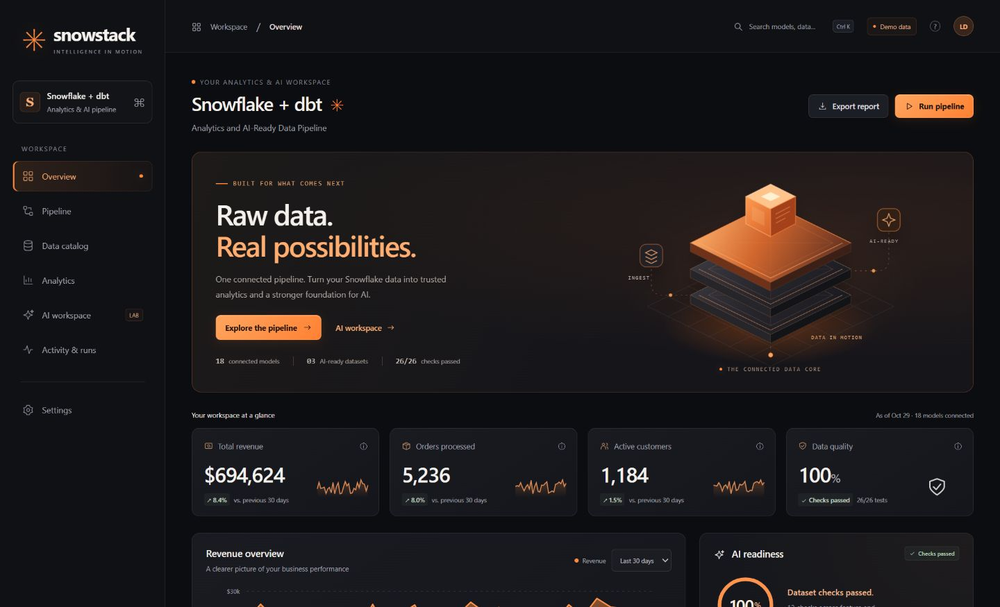
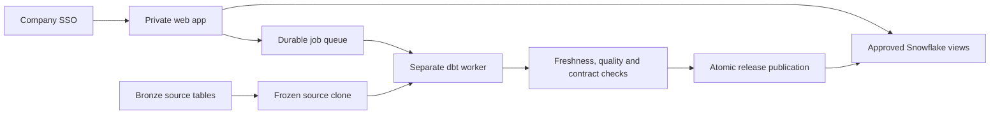

# Snowflake + dbt Analytics and AI-Ready Data Pipeline

A private analytics workspace with a dbt/Snowflake release pipeline, company SSO, viewer/operator roles, and validated datasets for analytics and AI workloads.

## Dashboard preview



## Run the local demonstration

Requires Node.js 24+:

```powershell
npm ci --ignore-scripts
npm start
```

After startup, open the address printed in your terminal. Demo mode binds to loopback and uses synthetic retail data in `.local/pipeline.sqlite`: 1,200 customers, 30 products, and 180 days of transactions. It never connects to Snowflake or an AI provider. The first-generated as-of date and run history persist across restarts.

`npm run dev` watches the server for development. Restart the server after editing static assets because production serving caches them at startup.

## Production architecture



The web process uses a reader identity; the worker uses a separate transformer identity. A successful build publishes an immutable release. Failed builds preserve the current dashboard data. The dashboard's reader role receives only explicit `APP_*` projections, which omit direct customer identifiers and deny newly added columns until approved.

Production refuses demo mode, missing SSO/Snowflake configuration, HTTP origins, and a transformer role in the web process. OIDC verifies signed tokens, issuer, audience, nonce, state, PKCE, and company groups. Server-side sessions, CSRF checks, permissions, query/request/export limits, audit records, and sanitized JSON logs are included.

**Deployment and operational instructions:** [docs/production.md](docs/production.md). That guide covers secrets, source migrations, Docker/TLS deployment, first publication, staging acceptance, backups, restore, rollback, monitoring, cost controls, and go-live gates.

The supplied architecture targets one private internal workspace on one host. Persistent SQLite stores operational state; Snowflake stores business data. Move operational state/coordination to a shared database before horizontal scaling or multi-tenant use.

## Workspace features

- Ember / Obsidian interface: orange accents, matte black surfaces, an animated isometric data sculpture, and a CSS 3D AI core. The artwork is local and respects reduced-motion preferences.
- Overview and analytics with 7/30/90-day comparisons and actual dataset checks.
- Searchable model catalog, dependencies, SQL, approved previews, and bounded operator CSV exports.
- Background build requests and durable activity history in production.
- SQL-based analytical questions about revenue, products, customers, and readiness, with source-model links.
- Settings that show the execution mode, access role, active release, and export policy.

There are 18 models: 3 staging, 3 silver, 9 gold, and 3 AI datasets. The local demonstration executes SQLite equivalents; production reads real Snowflake results from validated dbt builds.

| AI dataset | Purpose |
| --- | --- |
| `customer_features` | As-of recency, frequency, monetary value, 30/90-day activity, and pseudonymous keys |
| `product_knowledge` | Product documents with stable IDs and provenance for a future retrieval index |
| `daily_demand_features` | Availability-aware daily demand, zero-sales days, and strictly historical lags |

AI datasets have enforced column contracts and integrity checks. They are inputs to separately evaluated ML/retrieval systems. No trained model, forecast, embedding service, or LLM is implied. Customer hashes remain pseudonymous data. Production source creation dates and ingestion timestamps must be real, not fabricated.

## Validation

```powershell
npm run check
npm test
npm audit --omit=dev --audit-level=high
```

Local tests exercise deterministic transformations, reporting windows, reconciliation, redaction, future-data exclusion, rebuild/rollback behavior, signed OIDC flows and failure cases, sessions, CSRF, role enforcement, durable leases, publication gates, query bindings, and API limits.

Use Python 3.12 for dbt and SQL grammar checks. On Windows, a short virtual-environment/dependency path avoids legacy path-length failures in deeply nested folders:

SQLFluff is an optional development dependency in `requirements-dev.txt` and is excluded from the production image.

```powershell
python -m venv "$env:TEMP\snowstack-dbt-venv"
& "$env:TEMP\snowstack-dbt-venv\Scripts\Activate.ps1"
python -m pip install --require-hashes -r requirements.lock
$env:DBT_PACKAGES_INSTALL_PATH = Join-Path $env:TEMP 'snowstack-dbt-packages'
dbt deps --profiles-dir config
python scripts/validate_sql.py
```

`dbt parse` still needs the profile's environment values, even though it does not execute warehouse queries. CI supplies non-credential fixtures for structural parsing. Production execution requires the settings and source contract in the deployment guide. The default legacy development profile uses environment-based password authentication; the production worker uses key-pair authentication.

GitHub CI covers Windows/Linux application tests, dependency auditing, production dbt parsing, SQL grammar, container builds and runtime/configuration checks. A separate manually dispatched, credentialed workflow accepts only an isolated Snowflake database ending in `_CI`. No warehouse credentials are supplied to pull-request jobs.

## Repository layout

```text
app/                     Responsive browser workspace
server/                  HTTP API, SSO, operational state, worker, release logic
scripts/                 Validation, jobs, backups, deployment checks
models/{staging,silver,gold,ai}/
macros/                  Revenue, source columns, key derivation, production guards
config/profiles.yml      Environment-based development/production dbt profiles
sql/                     Source table contract and reviewed role setup template
deploy/                  Container composition, TLS proxy, example configuration
.github/workflows/       Application/container CI and staging warehouse acceptance
docs/production.md       Deployment, acceptance gates, operations and recovery
.local/                  Ignored development database and runtime artifacts
```

Project identifier: `snowflake_dbt_ai_pipeline`. Version 3.0.0. MIT license, retaining the original project's attribution in LICENSE.

